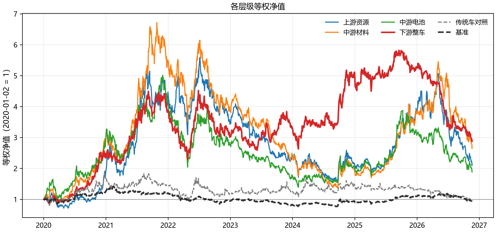

# 新能源车产业链：各环节是同步波动，还是依次传导？

2020-01-02 至 2026-11-20 · 31 只 A 股标的 + 沪深300 基准 · 1,668 个交易日 · 52,852 条日频观测



主文件是 [`01_nev_chain_analysis.ipynb`](01_nev_chain_analysis.ipynb)，从读数据到出图全部在 notebook 里，
执行一遍就能得到下面所有数字。不想开 Jupyter 可以看 [`导出的 HTML`](01_nev_chain_analysis.html)。

## 结论

- **传导时滞不存在。** 日、周、月三个频段 × 四条路径，交叉相关的最优滞后全部落在 0 期。
  同期相关随链条距离单调衰减（上游→电池 0.694，电池→整车 0.615，上游→整车 0.551），
  说明结构关系是真的，但滞后项没有增量信息。
- **联动正在瓦解。** 上下游 60 日滚动相关 2024-10-23 见顶 0.801，2026-10-13 跌到 0.109，最新 0.351。
  全期均值 0.542。
- **利润已经从上游迁回。** 上游/下游净值比 2022-03-25 见顶 1.588，现在 0.729，回落 54%。
- **高波动没换来高收益。** 31 只个股的年化波动与区间累计收益相关系数只有 +0.330（R² 0.109）。

## 各层级表现

| 层级 | 累计收益 | 年化收益 | 年化波动 | 最大回撤 | 当前历史分位 |
|---|---:|---:|---:|---:|---:|
| 下游整车 | +187.7% | 16.6% | 34.1% | −50.6% | 26% |
| 中游材料 | +164.8% | 15.2% | 42.5% | −79.5% | 43% |
| 上游资源 | +109.8% | 11.4% | 44.8% | −71.6% | 27% |
| 中游电池 | +88.1% | 9.6% | 43.2% | −72.3% | 23% |
| 传统车对照 | −6.9% | −1.0% | 34.7% | −50.2% | 2% |
| 沪深300 | −6.5% | −1.0% | 18.7% | −45.6% | 31% |

收益最高的一层（整车）恰好是风险最低的一层；中游材料收益排第二，回撤却是 −79.5%。
买"整条链"和买"整车"根本不是一个风险敞口。

## 怎么做的

按产业链位置把标的打成五层（上游资源 7 / 中游材料 9 / 中游电池 5 / 下游整车 8 / 传统车对照 2），
层内等权合成日收益，累乘成净值。然后做三件事：

1. **多频段交叉相关**。lag 按频段分别扫 ±20（日）、±12（周）、±6（月）期，取绝对相关最大的那一期。
2. **60 日滚动相关**，看联动强度本身随时间怎么变。
3. **上游/下游净值比**，作为利润分配位置的粗略代理。

数据是腾讯行情的前复权日线（经 akshare），采集脚本在 [`scripts/fetch_prices.py`](scripts/fetch_prices.py)。
仓库里带了 `data/raw_panel.csv` 快照，不联网也能重跑全部计算。

## 数据上的两个坑

- **盐湖股份停牌 16 个月**，2021-08-10 复牌当天相对 2020-04-29 涨了 +306.11%。这条记录不能当"一日收益"，
  否则上游那层的当日均值会被它一个人抬走四十多个点。层级收益用透视后的日历算 `pct_change()`，
  停牌日是 NaN，等权均值会自动跳过它。
- **交易日覆盖率**：盐湖股份 81.3%、孚能科技 91.8%（2020-07 才上市），其余都在 99% 以上。
  一律不插值。

## 复现

```bash
pip install pandas numpy matplotlib akshare
# 已有数据快照时直接跑 notebook 即可；要重新拉数：
python scripts/fetch_prices.py
jupyter lab 01_nev_chain_analysis.ipynb
```

## 没解决的

- **用股价代理景气度**，看到的是市场预期，不是产业基本面。这是这个分析最大的问题。
- 31 只标的是按产业链位置**主动筛选**的，不是全样本，有幸存者偏差。
- 等权合成，没按市值加权，小市值标的的影响被放大。
- 补贴退坡、购置税、疫情这些外生冲击没有单独剥离。

下一步想换成碳酸锂现货价、正极材料报价、月度排产和装机量，直接看基本面的传导时滞。
股价只能回答"市场怎么想"，回答不了"货什么时候到"。
