# Olist 电商订单分析

巴西电商平台 Olist 的公开交易数据（Kaggle，CC BY-NC-SA 4.0），2016-09 到 2018-10，
9 张关联表、99,441 笔订单、96,096 名客户。分析全部用 SQL 写，Python 只负责跑查询和出图。

起因是想练多表：单表数据谁都能做，星型模型 + 窗口函数才是数分岗每天在用的东西。
但做到一半发现数据里有个更有意思的问题——**这个平台几乎没有复购**。那它靠什么增长？
后面的分析基本都在追这一条线。

```bash
python scripts/fetch_data.py     # 下载 9 张表（约 43MB，免 token）
python scripts/audit.py          # 数据质量审计
python scripts/run_queries.py    # 跑 sql/ 下全部查询 → results/
python scripts/make_charts.py    # 出图（只读 results/，不重算）
```

原始 CSV 121MB 没有入库，跑一次 `fetch_data.py` 就有；`results/` 里是每条查询的输出，可以直接对着看。

## 结论

1. **97.0% 的客户终身只下过一单**（90,307 / 93,096）。把 7 天内的拆单排除后，真正回访过的人只有 1,816 个，占 1.95%。
2. **留存不是衰减曲线，是一条贴着 0.5% 的水平线**：M+1 平均 0.48%，M+3 0.25%，M+6 0.26%。
3. **RFM 在这份数据上失效**，这本身是个发现：F 维度 97% 的人都是 1，八分层里有六层没有区分度。
4. **履约链路很干净**（全长损耗 2.92%），问题不在丢单，在送达质量。
5. **晚到 4 天的单，平均评分从 4.04 掉到 2.11**；6.67% 的晚到订单制造了 32.6% 的差评。

## 交互看板

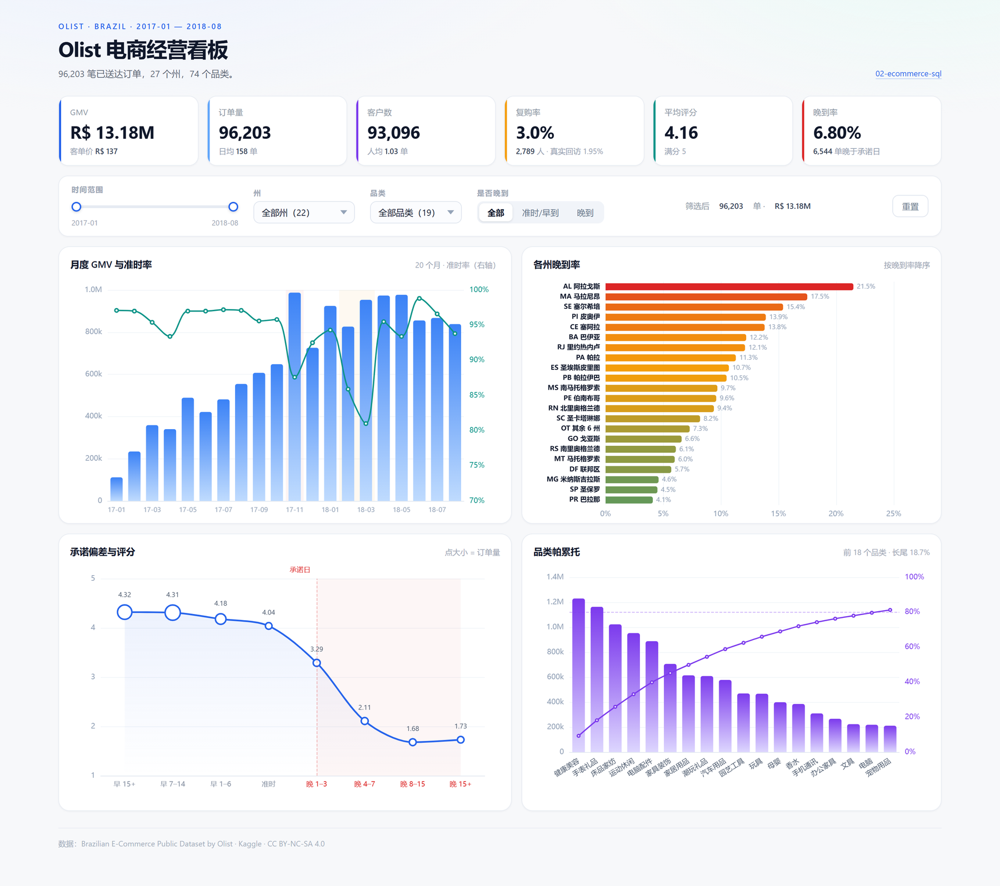

[`docs/index.html`](docs/index.html)：单文件、ECharts、双击即开。六个指标、四个筛选器，切换后全部图表重算。

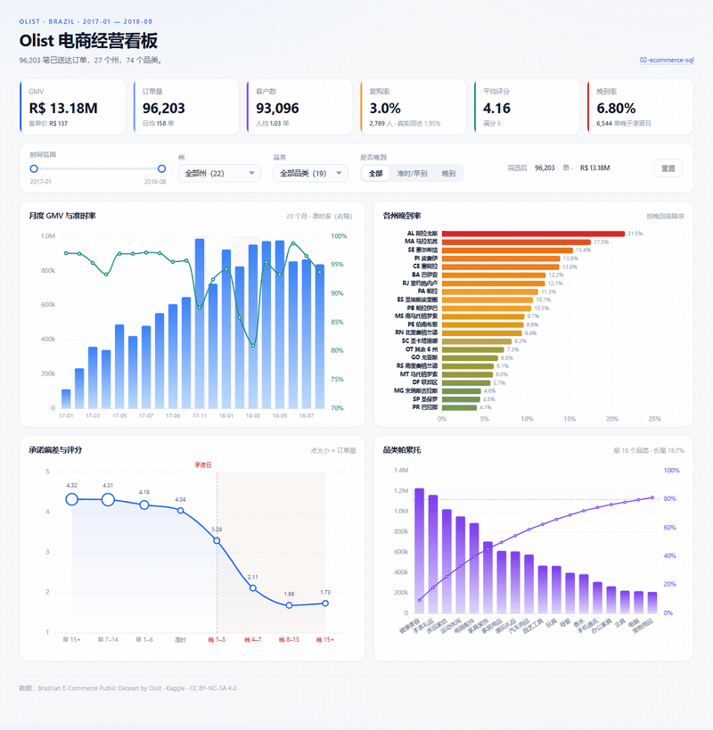

阿拉戈斯州、只看晚到单——晚到率 21.5% 的州，评分从 4.16 掉到 1.96：

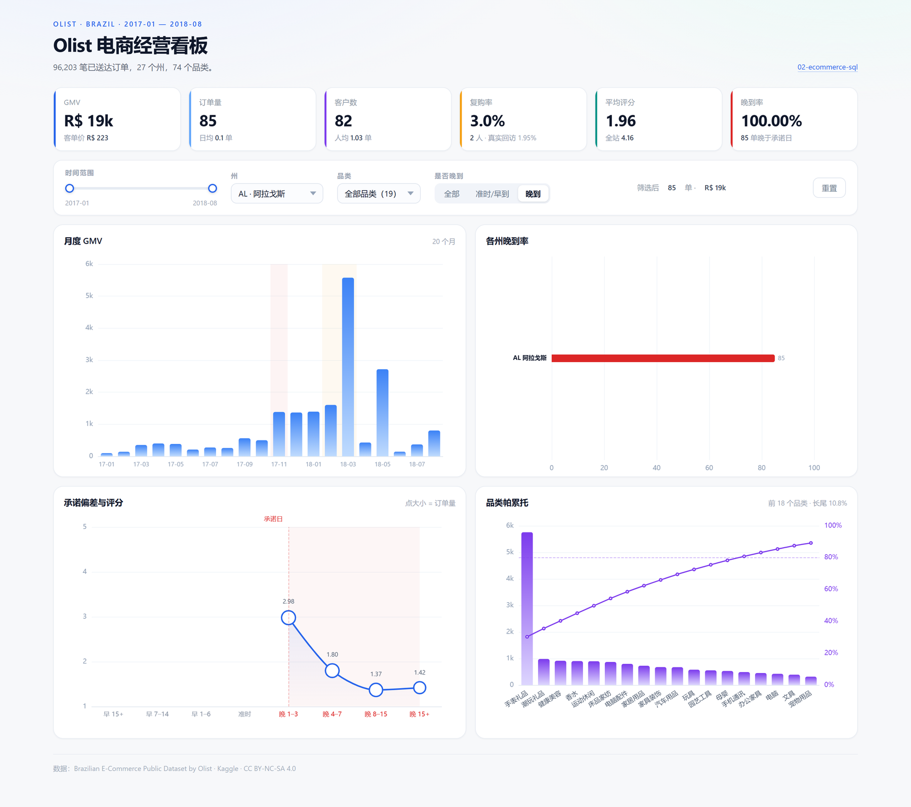

看板数据由 `python scripts/build_dashboard_data.py` 从 `results/` 的聚合结果拼成月 × 州 × 品类立方体，
再内联进 `index.html`。

## 表

| 表 | 行数 | 粒度 |
|---|---:|---|
| `orders` | 99,441 | 一行一笔订单，5 个时间戳 |
| `order_items` | 112,650 | 一行一个商品行 |
| `order_payments` | 103,886 | 一行一种支付方式 |
| `order_reviews` | 99,224 | 一行一条评价 |
| `customers` | 99,441 | 一行一个 `customer_id` |
| `products` | 32,951 | 一行一个 SKU |
| `sellers` | 3,095 | 一行一个卖家 |
| `product_category_name_translation` | 71 | 品类葡英对照 |

`scripts/db.py` 把 9 张 CSV 直接挂成 DuckDB 视图，不建库、不导入，字段类型在那里统一转型，
下游 SQL 就不用满屏 `CAST` 了。

## 口径

- 金额、时效、评分只取 `order_status = 'delivered'` 且送达时间非空
- 漏斗和取消率保留全状态
- 趋势与留存统一用 2017-01 — 2018-08，两头的截断月份（2016-09 只有 4 单、2018-09 只有 16 单）不进样本
- 时间差一律按 `DATEDIFF(day, ...)` 算。用时间戳直接比大小会把"承诺日当天下午送达"算成迟到，
  晚到率会虚高 1.4 个百分点（8.1% vs 6.7%）

## 一个文件一类问题

| SQL | 结果 | 内容 |
|---|---|---|
| [`sql/01_order_wide.sql`](sql/01_order_wide.sql) | `q1_order_wide_sample` | 六表 JOIN 的订单级宽表，后面所有查询都建在它上面 |
| [`sql/02_customer_structure.sql`](sql/02_customer_structure.sql) | `q2*` `q3*` | 复购序列、复购间隔、真实回访率、RFM |
| [`sql/03_cohort_retention.sql`](sql/03_cohort_retention.sql) | `q4_cohort` | 月度 cohort 留存 |
| [`sql/04_fulfillment_funnel.sql`](sql/04_fulfillment_funnel.sql) | `q5*` | 履约漏斗、支付确认时长 |
| [`sql/05_delivery_and_reviews.sql`](sql/05_delivery_and_reviews.sql) | `q6*` | 延误分箱、差评归因 |
| [`sql/06_category_and_region.sql`](sql/06_category_and_region.sql) | `q7`–`q9` | 品类帕累托、州维度、月度趋势 |

## 一、客户结构：一次性买卖

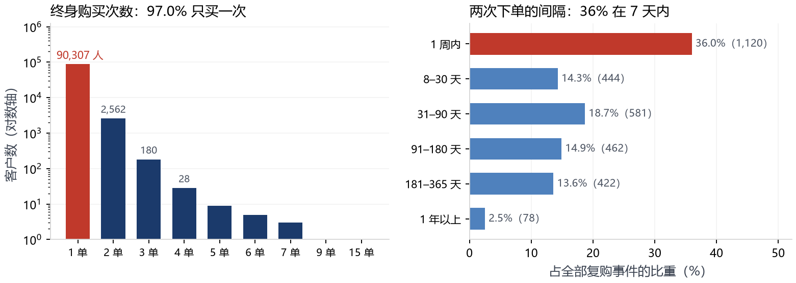

93,096 个有有效订单的客户里，90,307 人只买过一次。买过 3 次及以上的总共 227 人，占 0.24%。
买得最多的那个人下了 15 单。

剩下 3% 的复购还要再打折：**36% 的"复购"发生在 7 天以内**，其中不少是同一次购物被拆成多笔订单
（不同卖家分别发货）。只认间隔超过 7 天的回访，客户数掉到 1,816，占比 1.95%。

真复购的那部分节奏倒不慢：首购到二购的间隔中位数 29 天，均值 80.2 天。需求是存在的，只是频次太低。
家居、美妆这类品类，一个人一年买一两次就到顶了。

## 二、留存是一条平线

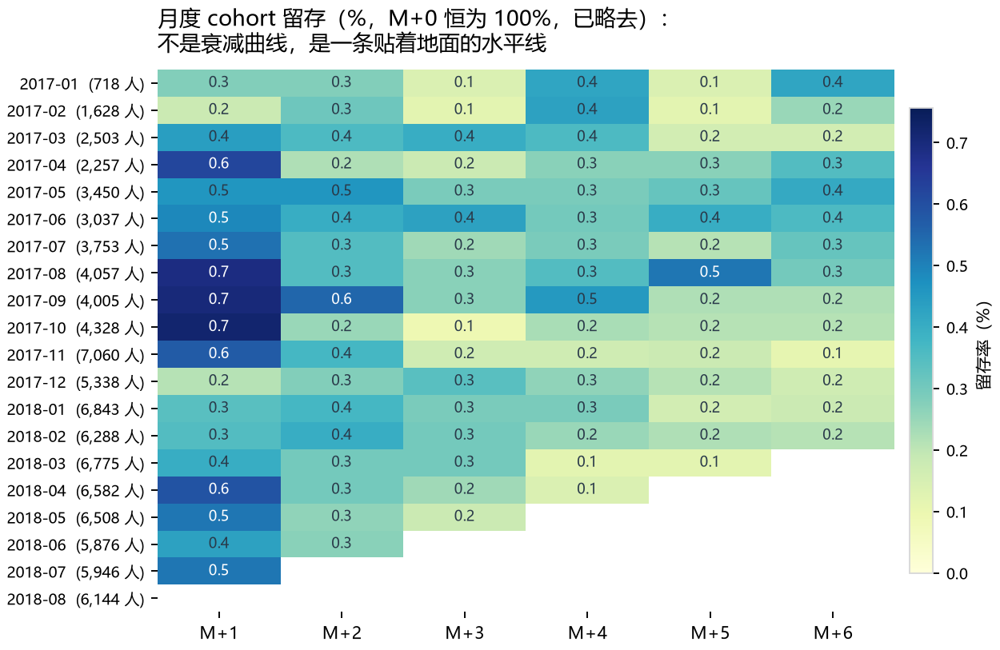

正常留存曲线是首月掉一半、之后逐月收敛，画出来是一条向右下滑的弧。这里不是。
20 个月度 cohort、人数从 718 到 7,060，M+1 平均 0.48%，M+3 0.25%，M+6 0.26%，三个月之后就不再往下掉。

一条平的、贴地的留存曲线意味着：**这个平台没有形成任何购买习惯**。客户不是"渐渐流失"，
是一开始就没被留住。那零点几个百分点更可能是同一批人的偶发需求在时间上的随机落点，
而不是残存用户。

顺带否掉两种常见做法：会员/积分体系（给 97% 不会回来的人发卡），
以及基于 RFM 的老客召回（被划进"重要挽留"的 2 万人，平均只买过 1 单，距上次购买已经 382 天）。

## 三、RFM 失效，这本身值得写下来

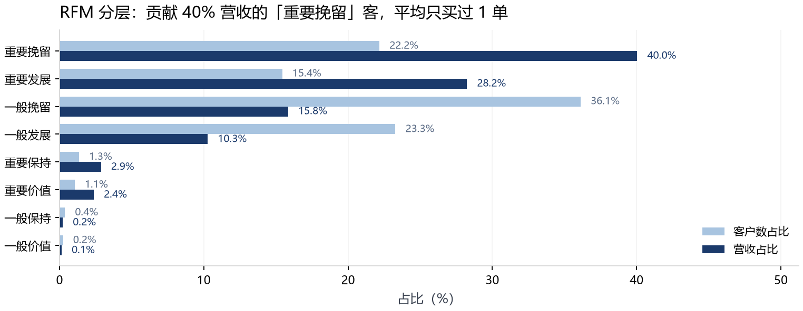

标准 RFM 的结果读起来很怪：贡献营收最多的是"重要挽留"（22.2% 的客户、40.0% 的营收），
教科书里最该重视的"重要价值"只有 1.05% 的客户、2.4% 的营收。

不是模型算错了，是 **F 维度没有方差**。97% 的人 F=1，"高频"那一档只装得下 2,789 人。
当一门生意本质上没有复购，RFM 就退化成一个"按金额分层 + 按时间分层"的二维模型。直接看这个二维：

| 金额四分位 | 客户类型 | 客户数 | 人均消费 | 营收占比 |
|---|---|---:|---:|---:|
| Q4 高 | 一次性 | 21,511 | R$ 391 | 54.66% |
| Q4 高 | 复购 | 1,763 | R$ 416 | 4.77% |
| Q3 | 一次性 | 22,582 | R$ 141 | 20.68% |
| Q3 | 复购 | 692 | R$ 145 | 0.65% |
| Q2 | 一次性 | 22,987 | R$ 83 | 12.48% |
| Q1 低 | 一次性 | 23,227 | R$ 44 | 6.58% |

高金额客户里 92.4% 是一次性客户（21,511 / 23,274），他们贡献了全站 54.7% 的营收。
复购客户人均 416、一次性客户人均 391，几乎没有差别——**复购没有带来更高的单客价值，只是同一个人多买了一次**。

结论很清楚：这钱是在客户第一次下单时赚到的。资源该压在第一次体验上。

## 四、履约链路本身很干净

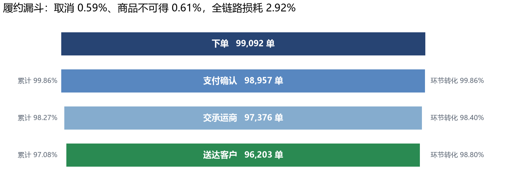

从下单到送达，跑完整条链的有 97.08%。细拆损耗：支付未确认 0.14%、取消 0.59%、商品不可得 0.61%、
在途未送达 1.58%。对一个覆盖 27 个州的 marketplace 来说，这个漏斗干净得有点意外。

有一个环节值得单独说。20% 的订单走 boleto，巴西那种线下付款、T+1 才清算的票据：

| 支付方式 | 订单数 | 确认时长中位数 | 均值 |
|---|---:|---:|---:|
| 信用卡 | 74,007 | 0 小时 | 4.4 小时 |
| boleto | 19,721 | 29 小时 | 33.1 小时 |
| 借记卡 | 1,525 | 1 小时 | 9.5 小时 |
| 代金券 | 1,596 | 1 小时 | 9.5 小时 |

确认中位数差 29 小时。这也解释了那 1,359 笔"承运早于支付确认"的记录——卖家看到票据开出来就发货了，
系统里的确认是后补的。

## 五、延误和评分

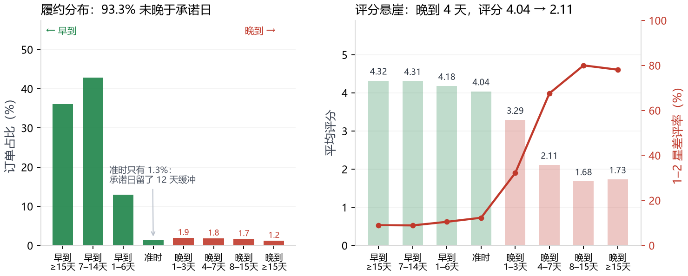

整个项目最陡的一条曲线。承诺日不是期望，是红线：

| 延误分档 | 订单占比 | 平均评分 | 差评率 |
|---|---:|---:|---:|
| 早到 15 天以上 | 36.13% | 4.32 | 9.0% |
| 早到 7–14 天 | 42.86% | 4.31 | 8.9% |
| 早到 1–6 天 | 12.99% | 4.18 | 10.5% |
| 准时 | 1.34% | 4.04 | 12.3% |
| 晚 1–3 天 | 1.94% | 3.29 | 32.2% |
| 晚 4–7 天 | 1.83% | 2.11 | 67.6% |
| 晚 8–15 天 | 1.68% | 1.68 | 80.0% |
| 晚 15 天以上 | 1.23% | 1.73 | 78.1% |

只要晚一天，差评率就翻三倍。平台给的承诺日期缓冲很厚：平均承诺 24.3 天，实际 12.5 天送达，
缓冲 11.8 天，所以 91.98% 的订单是早到的，1.34% 刚好踩在承诺日。真正晚的只有 6.67%，
但这 6.67% 造出了全部差评的 32.6%。

如果晚到率能从 6.7% 压到 2%（等于把现在晚到的单削掉七成），差评总量大概能少两成。
在复购率只有 3% 的平台上，这个杠杆比任何会员运营都值钱。

## 六、两次塌方

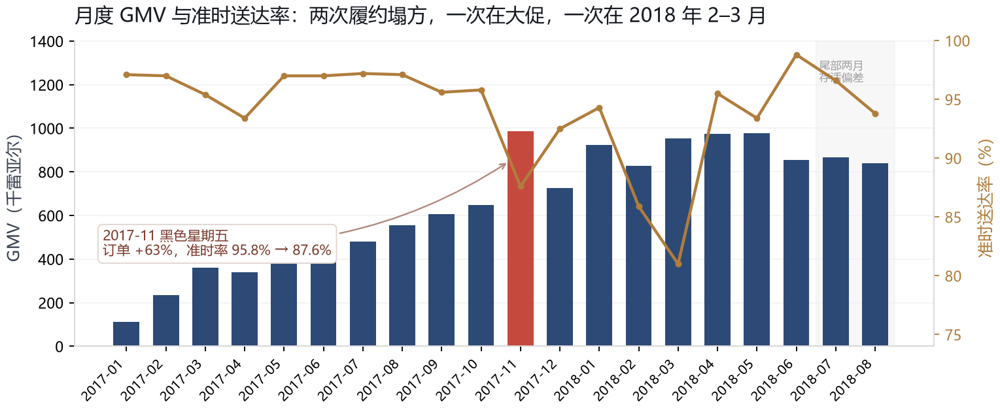

**2017 年 11 月黑五**：订单从 10 月的 4,478 单跳到 7,288 单（+62.8%），准时率 95.8% 掉到 87.6%，
平均评分 4.21 掉到 3.99，12 月才恢复。典型的产能被打穿——单量上去了，承运商和仓库的分拣没跟上。

**2018 年 2–3 月**更隐蔽：单量没涨（6,555 / 7,003 单，跟前后月份持平），但平均实送时长从 12 天
拉长到 16.9 / 16.2 天，准时率掉到 85.9% / 81.0%，评分跌到 3.88 / 3.81，同时承诺天数被下调到 25.2 / 22.7 天。
时效变差叠加承诺收紧，两头一挤就崩了。这更像一次运营策略调整失败，不是外部冲击。

## 七、地理

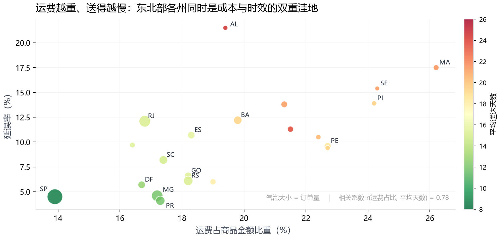

样本超过 300 单的 21 个州里，圣保罗占全部订单的 42%，运费只占 13.9%，平均 8.7 天送达，
延误率 4.5%。东北部的阿拉戈斯运费 19.4%、平均 24.5 天、延误率 21.5%；马拉尼昂运费 26.2%、延误率 17.5%。

州层面 r(运费占比, 平均送达天数) = 0.78，r(平均送达天数, 评分) = −0.84。
运费越贵的地方送得越慢，评分越低。

反直觉的一点：这些偏远州的客单价并不低，阿拉戈斯 199 雷亚尔，比圣保罗的 125 高 60%。
不是当地人更舍得花钱，是**低客单商品在那些地方根本卖不动**——运费按件计价，
一件 50 雷亚尔的商品加 20 的运费就没意义了，需求侧自动把它过滤掉。
高运费在这里是一个隐形的品类门槛，也解释了平台的天花板为什么锁在东南部。

## 八、品类：18 个覆盖八成营收

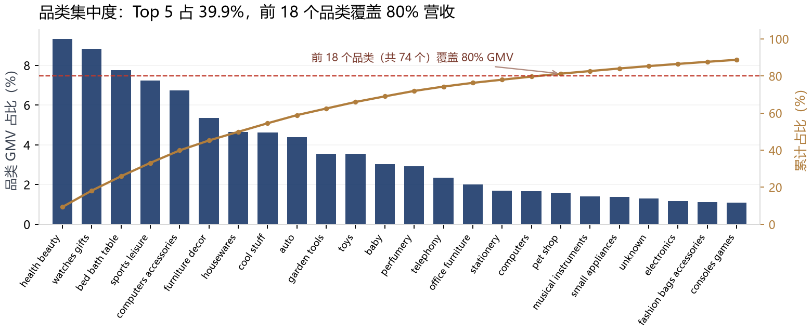

74 个品类里，健康美容 9.33%、手表礼品 8.83%、床品家纺 7.76%、运动休闲 7.23%、电脑配件 6.74%，
前五个合计 39.9%；累计到第 18 个（宠物用品）就到 81.29%。比典型的 80/20 稍微集中一点。

更值得看的是品类和履约的交叉：家具家居运费占 23.7%、家居用品 23.2%，明显高于全站加权均值 16.6%，
而这两类恰恰是体积大、易损、需要多次预约配送的东西。运费高、时效差、破损率高，
差评是三个来源叠出来的。

## 数据质量

审计脚本 `scripts/audit.py` 跑了 13 项检查，结果在 `data/audit_log.txt`。三条值得记：

- **评价表有 814 条重复 review_id**，按 order_id 聚合后关联，一单多评取均值
- 775 笔订单没有商品明细，全部是取消或不可得订单，金额类分析自然排除
- 380 笔订单的支付金额与商品金额对不上（0.39%），平均差额 R$ 0.03，是 voucher 分摊和运费合并造成的，保留原值

还有一个会让结论直接归零的坑：

> `customer_id` 是「一单一号」，同一自然人复购会拿到新 ID。用它算复购率永远是 0。
> 自然人标识是 `customer_unique_id`，99,441 笔订单对应 96,096 个人。

## 踩过的坑

- **NTILE 必须加 tiebreaker。** 只按 `recency_days` / `monetary` 排序时，分位边界上的并列行
  会因为执行顺序不同落到不同档，隔一天重跑人数就变了。`NTILE(5) OVER (ORDER BY monetary, uid)` 才稳定。
- **一单多品类**要先按订单聚合出金额最大的品类，`ROW_NUMBER()` 打标后取 `rk = 1`，
  否则 JOIN `order_items` 会把订单数放大 1.13 倍（99,441 → 112,650）。
- **准点判定按日粒度**，原因见上面「口径」。
- DuckDB 的 `read_csv` 不接受 DDL 字符串，`columns` 要写 `{'a': 'VARCHAR'}` 这种结构；
  带 BOM 的 CSV（品类翻译表）按位置映射，别依赖列名。

## 没做的

- **没有成本侧数据**。能算 GMV 和运费，算不出毛利、获客成本、履约成本，所以 LTV 是否覆盖 CAC 只能定性。
- **相关不是因果**。延误与低分的 r = −0.84，但低分也可能来自商品质量、描述不符。
  用"早到 vs 晚到"分组削弱了混淆，但没做断点回归之类的严格识别。
- **地理只到州一级**。数据里有邮编和经纬度，可以算真实配送距离，这次没做，州内差异被平均掉了。
- **复购口径敏感**。7 天拆单的处理是经验判断；改按 30 天，真实回访率会降到 1.5% 左右，
  方向不变但数值更低。
- **尾部被截断**。2018-07/08 的时效指标受"只统计已送达订单"的存活偏差影响，被系统性高估。

## 环境

DuckDB 2.0 ｜ Python 3.13 ｜ pandas 3.1 ｜ matplotlib 3.11

```bash
pip install duckdb pandas matplotlib
```

数据来源：[Brazilian E-Commerce Public Dataset by Olist](https://www.kaggle.com/datasets/olistbr/brazilian-ecommerce)，CC BY-NC-SA 4.0。
