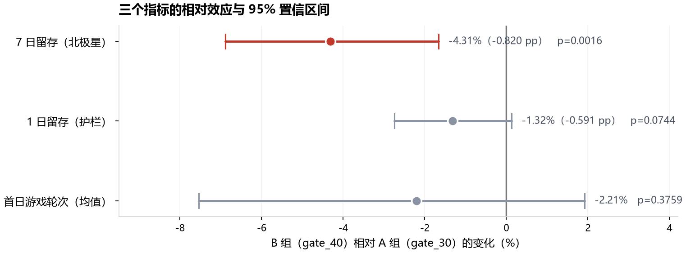

# Cookie Cats：第一道付费门该放第 30 关还是第 40 关

90,189 名新玩家的随机对照实验复盘。数据由 Tactile Entertainment 公开（经 DataCamp），
A 组 gate_30 44,700 人，B 组 gate_40 45,489 人。

**结论：不上线 gate_40。** 7 日留存从 19.02% 掉到 18.20%，绝对差 −0.82 pp、相对 −4.31%，
p = 0.0016，Holm 校正后 0.0047，贝叶斯后验 P(B 更差) = 99.93%。

完整的实验读数是这份：[`memo/cookie-cats-gate-readout.pdf`](memo/cookie-cats-gate-readout.pdf)（4 页，
含功效分析、SRM 处置、四个威胁的逐条排查）。源文件是 `memo/readout.html`。



## 这份分析里值得看的三处

**先算 MDE 再看 p 值。** 每组 44,700 人对应 7 日留存的检出下限是 0.73 pp、1 日留存是 0.93 pp。
1 日留存实测差 −0.59 pp、p = 0.0744，看着"不显著"，但这个差异本来就小于检出下限——
是证据不足，不是没影响。不先把这句话说清楚，后面所有"不显著"都会被误读。

**SRM 报警了，但没推翻实验。** A 49.56% / B 50.44%，χ² = 6.90，p = 0.0086。
九万人量级上 0.87 个百分点的偏差足以让卡方报警。数据只有 5 个字段，无法定位失衡来源，
也无法证明失衡与结果无关，所以这条被写成"记录在案"，而不是"已排除"。

**首日轮次的均值被一个人绑架。** 52.46 对 51.30 轮，Welch p = 0.3759。
去掉每组最大的一个观测，差值从 −1.16 轮缩到 −0.10 轮；中位数只有 17 与 16。
那位玩了 49,854 轮的 A 组玩家，一个人造成了几乎全部的组间差异。

## 目录

```
03-ab-testing/
├── memo/
│   ├── readout.html                    实验读数的源文件
│   └── cookie-cats-gate-readout.pdf    4 页 PDF
├── src/
│   ├── fetch.py                        下载 + SHA-256 校验（校验不过直接中止）
│   ├── analysis.py                     全部统计检验 → data/metrics.json
│   ├── charts.py                       六张图，只读 metrics.json 与原始 CSV
│   └── build_memo.py                   HTML → PDF
├── charts/                             六张图
└── data/
    ├── cookie_cats.csv                 90,189 行原始数据
    ├── metrics.json                    报告引用的全部数值
    └── analysis_log.txt                逐项检验的完整输出
```

## 复现

```bash
pip install pandas numpy scipy matplotlib pymupdf
python src/fetch.py        # 下载并校验，本地已有则跳过
python src/analysis.py     # 约 20 秒，随机种子 20261123
python src/charts.py
python src/build_memo.py   # 需要本机装有 Chrome
```

`analysis.py` 里覆盖的检验：两比例 z 检验、Wilson / Newcombe 区间、Welch t、Mann-Whitney U、
bootstrap、功效与 MDE 反解、SRM 卡方、Holm 与 BH 校正、分层与交互项、Beta-Binomial 贝叶斯复核、
2,000 次置换模拟的 peeking 曲线。

## 数据没有给的东西

- **没有时间戳**，新奇效应无法检验。留存差异可能来自真实体验，也可能只是"门变远了"的短期新鲜感。
- **没有前置协变量**，做不了 CUPED，也无法解释 SRM。
- **没有收入数据**。如果 gate_40 提升了付费转化或 ARPU，留存损失有可能被部分抵消，
  这个权衡做不了——这是结论最大的适用边界。
- 窗口只有 7 天，单一游戏、单一市场，不能外推。
